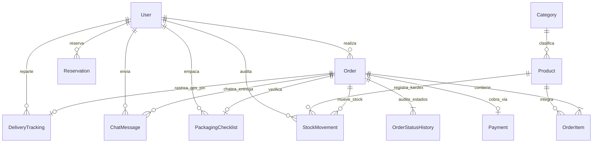
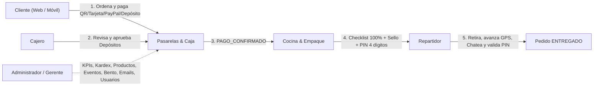

# 05 — Guía Maestra de Exposición, Arquitectura, APIs, Base de Datos y Prompts (Joy Ride Café® Sucre)

Este documento reúne el mapa exacto del proyecto para estudiar, explicar y defender el sistema completo ante tu docente o tribunal, junto con **7 prompts maestros listos para copiar** y generar diapositivas, guiones orales, preguntas tipo defensa y diagramas adicionales.

---

## 1. Árbol Real del Proyecto (Dónde está cada cosa)

```text
joyride-cafe-sucre/
├── package.json                          # Monorepo scripts: dev, build, db:local, dns:setup, test:e2e
├── render.yaml                           # Blueprint 1-clic para Render + PostgreSQL administrado
├── .env.example                          # Plantilla de variables de entorno (JWT, PayPal, Stripe, Gmail SMTP)
├── docs/
│   ├── 01-ARQUITECTURA-Y-ENFOQUE.md      # Visión general de ingeniería y diseño
│   ├── 02-TIMELINE-Y-HANDOFF.md          # Bitácora técnica de entregas
│   ├── 03-MATRIZ-SIS324-Y-DEFENSA.md     # Matriz de evaluación docente y guión 3 minutos
│   ├── 04-DEPLOY-DNS-Y-TUNEL-ENVIVO.md   # DNS local (.local), Render y túnel HTTPS en vivo
│   └── 05-PROMPTS-EXPOSICION-Y-ARQUITECTURA.md  # Esta guía + prompts de exposición
├── scripts/
│   ├── dev-db.mjs                        # PostgreSQL local embebido automático (puerto 5433)
│   ├── crop-qr-bnb.mjs                   # Recorte exacto de la matriz QR real del BNB
│   └── setup-local-dns.ps1               # DNS amigable http://joyride.local:4000 en Windows
├── server/                               # Backend Node.js + Express + TypeScript + Prisma ORM
│   ├── prisma/
│   │   ├── schema.prisma                 # 16 modelos relacionales + 7 enums PostgreSQL
│   │   └── seed.ts                       # Poblado idempotente (34 platos, 5 roles, eventos, reservas)
│   ├── scripts/test-e2e.ts               # Suite automatizada de 16 bloques End-to-End
│   └── src/
│       ├── index.ts                      # Express, Helmet, CORS estricto, /uploads sandbox, SSE, SPA host
│       ├── config/                       # env.ts (variables) y prisma.ts (cliente singleton)
│       ├── middleware/                   # auth.middleware (JWT+RBAC), rateLimit.middleware, error.middleware
│       ├── validators/schemas.ts         # Validación estricta de entrada con Zod
│       ├── utils/                        # jwt.ts, hmac.ts (SHA-256 QR/códigos), sse.ts (Server-Sent Events)
│       ├── routes/                       # Controladores HTTP RESTful por dominio (11 módulos)
│       └── services/                     # Lógica transaccional (inventory, payment, paypal, stripe, empaque, delivery, email)
└── client/                               # Frontend React 18 + TypeScript + Vite + Tailwind + Framer Motion
    ├── public/
    │   ├── manifest.webmanifest          # Manifiesto PWA instalable en Android / iOS
    │   ├── sw.js                         # Service Worker ligero para instalación móvil y caché de recursos
    │   └── images/ & assets/brand/       # Galería real del local + QR BNB recortado
    └── src/
        ├── App.tsx                       # Enrutador animado y rutas protegidas por rol (/, /carta, /mapa-sucre, /panel/*)
        ├── context/                      # AuthContext, CartContext (localStorage), ThemeContext, I18nContext, ToastContext
        ├── hooks/                        # useOrderStream (SSE en vivo), useDocumentTitle
        ├── lib/                          # api.ts (Axios + refresh JWT), sound.ts (Web Audio), format.ts, constants.ts
        ├── pages/                        # HomePage, MenuPage (/carta), SucreMapGuidePage, AuthSplitPage, MyOrdersPage, QrMobileGatewayPage
        ├── pages/panels/                 # CashierPanel, PackerPanel, RiderPanel, AdminPanel
        └── components/                   # home/, modals/, maps/, chat/, layout/, ui/
```

---

## 2. Tecnologías Usadas y Cómo Interactúan

| Capa | Tecnologías clave | Por qué se eligió y dónde vive |
|---|---|---|
| **Frontend** | React 18, TypeScript, Vite 6, Tailwind CSS 3, Framer Motion, TanStack React Query v5, Recharts | SPA ultrarrápida con animaciones limpias, tema Claro/Oscuro (`data-theme`), i18n `ES/EN`, audio Web Audio API y gráficos Admin. |
| **Mapas & Geo** | Leaflet 1.9.4 + Esri `World_Topo_Map` + OSRM Foot/Driving Routing + Nominatim Reverse Geocoding | Trazado en relieve e hiperrealista **sin API Keys pagas**: cálculo de distancia/tiempo a pie o entrega y pin GPS exacto en Checkout. |
| **Backend API** | Node.js 22, Express 4, TypeScript 5, Zod, Helmet, CORS, bcryptjs, JWT (`jsonwebtoken`), Nodemailer | API RESTful tipada, validación de esquemas antes de tocar la BD, limitación anti fuerza bruta (429), cabeceras HTTP seguras y envío de correos HTML. |
| **Base de Datos** | PostgreSQL + Prisma ORM v6 | Integridad referencial y **transacciones ACID (`prisma.$transaction`)** para que dos personas nunca compren la última unidad al mismo tiempo. |
| **Tiempo Real** | Server-Sent Events (`/api/events/stream`) + AJAX Polling de respaldo | Cambios instantáneos de estado del pedido, cola de Cocina/Empaque, ubicación GPS del repartidor y chat Cliente ↔ Repartidor. |
| **Pagos & Correos** | Simple QR BNB (HMAC-SHA256) · Depósito Bancario · PayPal Orders API v2 · Stripe PaymentIntents · Gmail SMTP / Resend | 4 métodos reales/verificables con cálculo de totales **100% en servidor desde PostgreSQL**, más recibos y alertas HTML automáticas. |

---

## 3. API REST vs API RESTful en Nuestro Proyecto

> **Diferencia clara para defender ante el docente:**
> - **API REST:** cualquier arquitectura cliente–servidor sobre HTTP sin estado que expone recursos en JSON.
> - **API RESTful:** implementación disciplinada de REST que **respeta estrictamente**:
>   1. **URIs orientadas a recursos** (sustantivos en plural como `/api/products`, `/api/orders`, `/api/events`, nunca verbos como `/getProducts`).
>   2. **Semántica correcta de verbos HTTP** (`GET` lectura segura, `POST` creación/acción transaccional, `PUT` reemplazo completo, `PATCH` modificación parcial de estado/checklist/ubicación, `DELETE` eliminación).
>   3. **Códigos de estado HTTP reales y significativos** (`200 OK`, `201 Created`, `400 Bad Request` Zod, `401 Unauthorized` JWT faltante/inválido, `403 Forbidden` rol o propietario incorrecto, `404 Not Found`, `409 Conflict` stock insuficiente o salto de estado, `429 Too Many Requests` rate limit).
>   4. **Stateless (Sin estado en sesión):** cada petición porta su propio `Bearer JWT` sin depender de sesiones de memoria del servidor.

### Inventario Completo de Endpoints RESTful

| Dominio | Método y Endpoint | Rol / Auth | Propósito y Seguridad |
|---|---|---|---|
| **Salud & Stream** | `GET /api/health` | Público | Verifica conexión real a PostgreSQL (`SELECT 1`). |
| | `GET /api/events/stream` | `optionalAuth` | Canal SSE filtrado estrictamente por `role` staff u `orderId`. |
| **Autenticación** | `POST /api/auth/register` | Público (40/15m) | Crea usuario forzando `Role.CLIENTE` (ignora roles falsos). |
| | `POST /api/auth/login` | Público (40/15m) | Verifica hash `bcryptjs` y emite `accessToken` + `refreshToken`. |
| | `POST /api/auth/refresh` | Público | Renueva par de tokens tras verificar firma refresh JWT. |
| | `GET /api/auth/me` | `requireAuth` | Perfil autenticado del usuario actual. |
| **Catálogo & Eventos** | `GET /api/categories` | Público | Lista categorías activas con conteo real de platos disponibles. |
| | `GET /api/products` | `optionalAuth` | Catálogo vivo; `includeInactive=true` permitido **solo a `ADMIN`**. |
| | `GET /api/promotions` | Público | Tarjetas Bento activas (*Ritmo Joy Ride en Sucre*). |
| | `GET /api/events` | Público | Cartelera activa de eventos y ruta turística de Sucre. |
| **Pagos (4 pasarelas)** | `POST /api/payments/qr/initiate` | `requireAuth` | Reserva stock atómico y genera token QR firmado con HMAC-SHA256. |
| | `GET /api/payments/qr/info/:qrToken` | Público | Consulta estado e importe para pasarela móvil `/pagar-qr/:token`. |
| | `POST /api/payments/qr/confirm/:qrToken` | Público (40/15m) | Confirma QR en vivo, consolida Kardex y notifica Cocina + Email. |
| | `POST /api/payments/deposit/submit` | `requireAuth` | Registra transferencia, guarda captura local segura y encola en Caja. |
| | `GET /api/cajero/payments` · `PATCH /.../review` | `CAJERO \| ADMIN` | Aprueba (pasa a Cocina) o rechaza (restituye stock automáticamente). |
| | `GET /api/payments/paypal/config` · `POST /create-order` · `/capture-order` · `/cancel-order/:id` | `requireAuth` | Creación y captura PayPal Orders v2 (o Sandbox Express) con control de propiedad. |
| | `GET /api/payments/stripe/config` · `POST /create-intent` · `/confirm-intent` · `/cancel-intent/:id` | `requireAuth` | Stripe PaymentIntents API (o Test Express) con precios calculados en servidor. |
| **Pedidos & Tracking** | `GET /api/orders/mine` · `GET /api/orders/:id` · `POST /api/orders/:id/cancel` | `requireAuth` | Historial del cliente, detalle auditable (oculta PIN al `REPARTIDOR`) y cancelación. |
| **Empaque (Kanban)** | `GET /api/empaque/orders` · `PATCH /start` · `PATCH /checklist` · `PATCH /finish-packing` | `EMPAQUETADOR \| ADMIN` | Máquina de estados y checklist 100% obligatorio antes de emitir PIN de 4 dígitos. |
| **Entrega & GPS** | `GET /api/delivery/orders` · `PATCH /pickup` · `PATCH /deliver` (20/15m) · `PATCH /location` | `REPARTIDOR \| ADMIN` | Retiro `EMPACADO → EN_CAMINO`, avance GPS y cierre estricto validando PIN del cliente. |
| **Reservas & Chats** | `GET /api/reservations/availability` · `POST /api/reservations` · `GET /` · `PATCH /:id/status` | Mixto | Disponibilidad por zona, pase QR de mesa y aviso automático HTML a Gerencia. |
| | `GET \| POST /api/chat/order/:orderId` · `GET \| POST /api/chat/staff` | `requireAuth` | Chat en vivo Cliente ↔ Repartidor (Admin solo lectura) y chat operativo interno. |
| **Reseñas & Club** | `GET /api/reviews` · `POST /api/reviews` | Lectura Púb. / Escritura Auth | Publicación autenticada con validación anti-XSS en URLs de foto. |
| | `POST /api/newsletter/subscribe` | Público (40/15m) | Registro al boletín de novedades y cartelera nocturna. |
| **Administración** | `GET /api/admin/analytics` · `GET /kardex` · `POST/PUT /products` · `POST /stock` | `ADMIN` | KPIs por pasarela, Kardex, CRUD de catálogo y ajustes de inventario con motivo. |
| | `GET/POST/PUT/PATCH/DELETE /api/admin/events` · `GET/PUT/PATCH /promotions` · `POST /media/upload` | `ADMIN` | Editor total de eventos, videos MP4/WEBM, fotos y tarjetas Bento de portada. |
| | `GET /api/admin/emails` · `POST /emails/campaign` · `POST /emails/send-suite` · `PATCH /users/:id` | `ADMIN` | Bandeja y visor HTML de correos, envío de campañas y gestión de roles. |

---

## 4. API Keys, Credenciales y Seguridad Web (`F12`)

- **Cero secretos en el navegador:** únicamente se exponen llaves públicas (`publishableKey` / `clientId`) vía `/config` cuando existen; `JWT_SECRET`, `HMAC_SECRET`, `PAYPAL_CLIENT_SECRET`, `STRIPE_SECRET_KEY`, `SMTP_PASS` y `DATABASE_URL` permanecen aislados en `server/.env` / variables privadas de Render.
- **Anti-manipulación desde DevTools (`F12`):**
  - El navegador **no envía precios ni totales**: aunque un usuario modifique el payload vía `fetch` en consola (`totalBs: 0.01`), `reserveStockTx` ignora el monto y calcula el subtotal leyendo `Product.precioBs` directo desde PostgreSQL.
  - Si un atacante intenta inyectar `role: "ADMIN"` al registrarse, `auth.routes.ts` fuerza `Role.CLIENTE`.
  - Si un usuario autenticado intenta confirmar el pago de la orden de otro cliente, `paypal.service.ts` y `stripe.service.ts` responden `403 Forbidden`.
  - Ningún estado puede saltarse pasos (`PENDIENTE_PAGO` no salta a `ENTREGADO`): `transitionOrderStatusTx` valida la máquina de estados completa.
  - Rate-limiting por IP, CORS estricto por lista blanca, `/uploads` con `Content-Security-Policy: ... sandbox` + `X-Content-Type-Options: nosniff`, `Cache-Control: no-store` en rutas sensibles y `escapeHtml()` en correos HTML.

---

## 5. Diagrama Entidad-Relación de Base de Datos (PostgreSQL / Prisma)



*(Modelos independientes de contenido y comunicación: `Promotion`, `Event`, `Review`, `NewsletterSubscriber`, `EmailLog`.)*

---

## 6. Diagrama de Actores y Flujo Operativo (5 Roles)



---

## 7. Prompts Maestros Listos para Preparar tu Exposición

Copia y pega cualquiera de estos prompts en Antigravity, Gemini o ChatGPT cuando quieras generar material específico de estudio o exposición:

### Prompt 1 — Resumen Ejecutivo y Diapositivas (10–12 slides)
> "Actúa como arquitecto de software senior. Con base en la documentación de `docs/05-PROMPTS-EXPOSICION-Y-ARQUITECTURA.md` del proyecto Joy Ride Café® Sucre, diseña una presentación de 11 diapositivas claras y visuales para defender un proyecto de E-Commerce & Logística (SIS324). Incluye: Problema real del negocio, Arquitectura Cliente-Servidor, Base de Datos PostgreSQL (atomicidad de stock y Kardex), Pasarelas de Pago (QR BNB HMAC, Depósito Bancario, PayPal y Stripe), Máquina de Estados de 5 Roles con PIN de entrega, Mapa sin costo API, Seguridad anti-F12 y Despliegue en Render. Dame título, 3 viñetas clave y qué mostrar en pantalla en vivo para cada diapositiva."

### Prompt 2 — Explicación Técnica de APIs RESTful y Endpoints
> "Explícame como para un tribunal universitario la diferencia entre API REST y API RESTful usando ejemplos reales tomados de `server/src/routes/payments.routes.ts`, `orders.routes.ts`, `empaque.routes.ts` y `delivery.routes.ts` de Joy Ride Café® Sucre. Detalla los códigos HTTP (`200`, `201`, `400`, `401`, `403`, `409`, `429`), por qué nuestra API es stateless con JWT y qué devuelve el endpoint `/api/payments/stripe/create-intent` si alguien manipula el precio desde el navegador."

### Prompt 3 — Base de Datos, Transacciones ACID y Control de Concurrencia
> "Genera una guía de estudio sobre el modelo relacional `server/prisma/schema.prisma` y `server/src/services/inventory.service.ts` de Joy Ride Café® Sucre. Explica paso a paso cómo `stockDisponible` pasa a `stockReservado` y luego a venta confirmada o liberación automática, cómo el Kardex (`StockMovement`) audita cada unidad, y qué ocurre si dos clientes compran simultáneamente el último plato disponible."

### Prompt 4 — Auditoría de Seguridad Web y Protección contra Manipulación (`F12`)
> "Resume todas las defensas de ciberseguridad implementadas en Joy Ride Café® Sucre (`server/src/index.ts`, `rateLimit.middleware.ts`, `auth.middleware.ts`, `sse.ts`, `email.service.ts`, `reviews.routes.ts`, `stripe.service.ts`). Para cada ataque común desde DevTools (cambiar precio en checkout, escalar rol a ADMIN en registro, leer pedidos ajenos por SSE, fuerza bruta al PIN de 4 dígitos, XSS en reseñas o correos), explica en 2 frases qué pasaría y qué archivo/línea lo bloquea."

### Prompt 5 — Roles, Actores y Flujo Logístico Completo (Guión de Demo en Vivo)
> "Crea un guión paso a paso de 4 minutos para demostrar en vivo los 5 actores (`CLIENTE`, `CAJERO`, `EMPAQUETADOR`, `REPARTIDOR`, `ADMIN`) en Joy Ride Café® Sucre usando las cuentas de acceso rápido. Indica exactamente qué ventana/pestaña abrir, qué botones pulsar en `/`, `/carta`, `/mapa-sucre`, Caja, Cocina, Repartidor y Admin, y qué resaltar verbalmente ante el docente en cada transición."

### Prompt 6 — Diagramas Visuales (Secuencia, Casos de Uso y ER) en Mermaid / PlantUML
> "Lee `server/prisma/schema.prisma`, `server/src/services/order-state.service.ts` y `server/src/routes/`. Genera en formato Mermaid listo para renderizar: 1) Diagrama de Secuencia completo desde que el cliente paga por QR/Tarjeta/PayPal hasta que el repartidor ingresa el PIN, 2) Diagrama de Estados (`OrderStatus`), y 3) Diagrama de Casos de Uso separado por los 5 actores del sistema."

### Prompt 7 — Banco de 15 Preguntas Difíciles del Docente con Respuestas Ganadoras
> "Imagina que eres el docente evaluador de SIS324 y quieres poner a prueba mi dominio real sobre el proyecto Joy Ride Café® Sucre. Hazme las 15 preguntas más difíciles sobre: JWT vs Cookies, por qué usamos Stripe/PayPal en servidor y no solo frontend, por qué Leaflet + OSRM no cobra API Keys, cómo funcionan los correos HTML SMTP vs vista previa, por qué el carrito usa `localStorage`, cómo evitamos estados saltados y cómo escala en Render + PostgreSQL. Incluye debajo de cada pregunta la respuesta técnica precisa, directa y sin rodeos."
